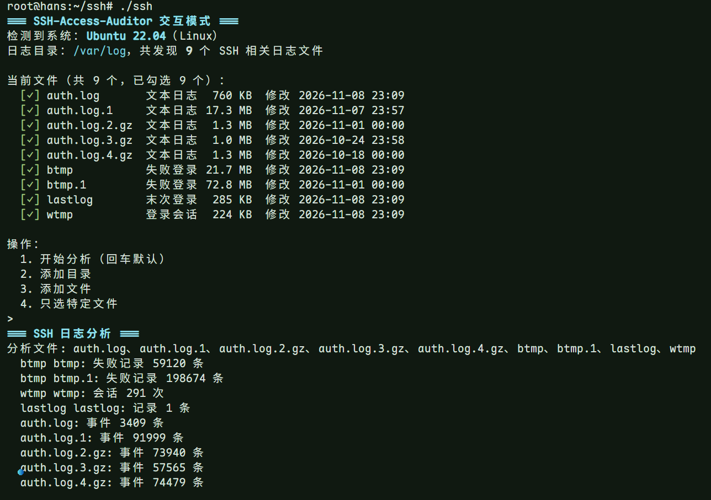
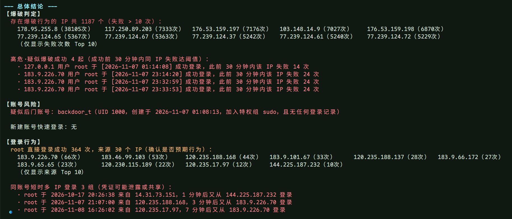
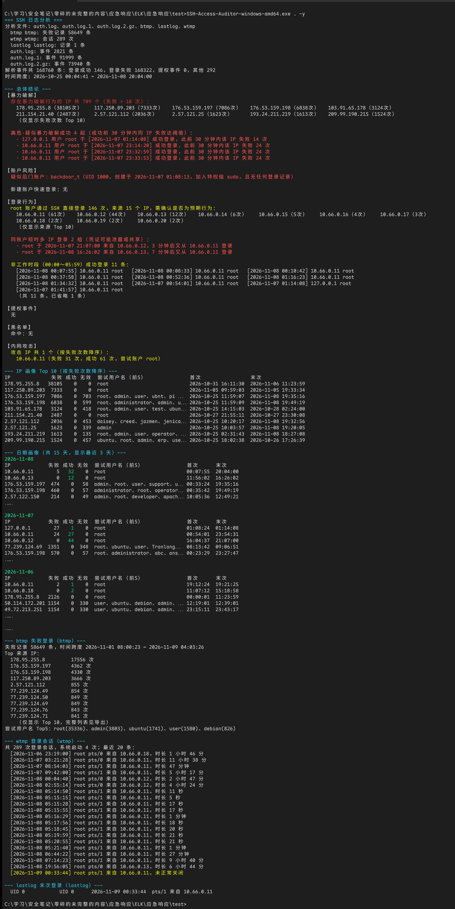
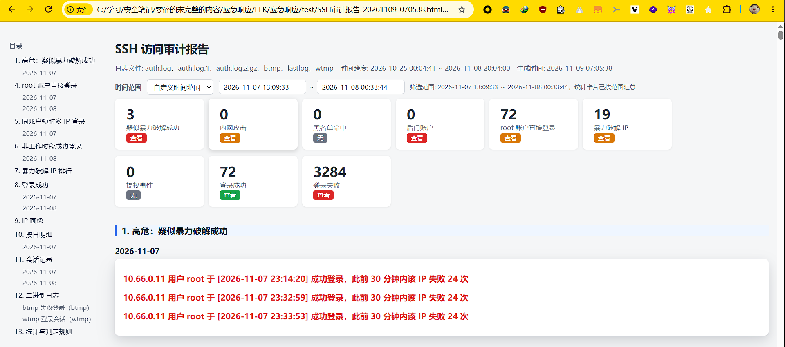

# SSH-Access-Auditor

Linux SSH 日志应急排查工具。

## 一、快速上手

### 交互模式

上传对应架构的二进制到服务器，赋予执行权限后不带参数运行：

```shell
chmod +x SSH-Access-Auditor-linux-amd64

./SSH-Access-Auditor-linux-amd64
```

程序自动发现 `/var/log` 下的 SSH 日志并全部勾选，回车开始分析，结果直接输出到终端。





### 参数模式

其它常用命令：

```shell
### 扫描指定目录，自动识别日志文件
./SSH-Access-Auditor-linux-amd64 /var/log/

### 指定日志文件，生成 HTML 报告
./SSH-Access-Auditor-linux-amd64 /var/log/auth.log -o report.html

### 大日志只看 Top 10 失败 IP 汇总
./SSH-Access-Auditor-linux-amd64 /var/log/auth.log -f --top 10

### 自动化：免交互输出文本报告并导出 CSV 事件
./SSH-Access-Auditor-linux-amd64 /var/log/auth.log -y -o report.txt --export csv

### 自定义阈值与时间窗（登录成功前 60 分钟内，若登录失败超过 20 次，判定为疑似暴力破解成功）
./SSH-Access-Auditor-linux-amd64 /var/log/auth.log --threshold 20 --window 60

### 加载 IP 黑名单
./SSH-Access-Auditor-linux-amd64 /var/log/auth.log --blacklist iplist.txt
```





## 二、功能

### 2.1 检测项

- 暴力破解 IP 判定：失败类次数合计超过阈值（默认 10）
- 疑似暴力破解成功：成功登录前 30 分钟内同 IP 失败达到阈值，判定为高危
- 内网攻击：来源 IP 属于私网段（10/8、172.16/12、192.168/16）且存在失败类事件即列出，提示失陷内网主机横向移动
- 后门账户：新建账户 UID 为 0 或加入 sudo、wheel、adm、admin、root 组，结合 lastlog 标注无任何登录记录的休眠后门
- 新建账户首次登录关联：useradd 后 7 天内首次登录的来源 IP
- root 账户直接登录、同账户 10 分钟内多 IP 登录、非工作时段（00:00～05:59）成功登录
- sudo 与 su 提权：命令明细与认证失败事件
- 非 22 端口成功登录、未正常关闭与超 24 小时的会话提示
- IP 画像：每个 IP 的失败、成功、无效用户计数，尝试过的用户名，首次与末次出现
- 离线 IP 黑名单（每行一个 IP 或 CIDR），命中标记

### 2.2 支持的日志

- 文本日志：`auth.log`（Debian/Ubuntu 系）、`secure`（RHEL/CentOS 系）与轮转归档（`auth.log.1`、`secure-20240101.gz` 一类）默认自动发现
- 任意文本文件：菜单「添加目录 / 添加文件」或命令行手动添加即可解析，`.gz` 按文件内容识别，改名不影响解压
- 二进制日志：`btmp`（失败登录）、`wtmp`（登录会话）、`lastlog`（各账户末次登录），独立统计不与文本日志重复计数，按文件名识别，手动添加时保持原名
- journald 兜底：无文本日志时自动提取最近 30 天 sshd 日志，需要 root 或 systemd-journal 组权限
- 兼容格式：`sshd[pid]` 与 `sshd-session[pid]` 两种格式，英文与中文日期，IPv4 与 IPv6
- 解析事件：登录成功、认证失败、无效用户、认证超限、认证中断、会话开启与关闭、新建账户、组添加、sudo 与 su 提权
- 计数口径：无用户名的认证中断计入失败（用户名记为未知），无年份日志按文件修改时间推断年份，跨年场景需人工复核

## 三、用法

### 3.1 交互模式

不带参数运行即进入交互模式：

- 自动识别发行版，列出 SSH 相关日志并全部勾选，回车开始分析
- 菜单选「只选特定文件」勾选部分文件：上下方向键移动，空格切换勾选，`a` 全选或全不选，回车确认，`q` 取消恢复
- 终端不支持方向键时自动回退为数字选择模式
- 分析完成后进入「退出 / 导出」菜单，选「导出」勾选格式，默认勾选 TXT 与 HTML
- 导出文件名默认 `SSH审计报告_YYYYMMDD_HHMMSS.扩展名`，生成到当前目录

### 3.2 参数模式

命令行直接接文件或目录（目录只做一层发现，多参数合并去重）。分析结果输出到终端后进入「退出 / 导出」菜单：

```shell
./SSH-Access-Auditor-linux-amd64 /var/log/auth.log /var/log/btmp
```

参数说明：

| 参数 | 作用 |
| :- | :- |
| `-a` | 屏幕追加显示认证成功的登录记录及统计 |
| `-f` | 屏幕追加显示认证失败的登录尝试及统计 |
| `-o FILE` | 生成审计报告，`.html` 后缀生成 HTML，其余为文本 |
| `--export json,csv` | 导出结构化事件，逗号分隔可复选 |
| `--top N` | 汇总模式，失败明细只显示 Top N 攻击 IP |
| `--threshold N` | 暴力破解判定阈值，默认 10 |
| `--window N` | 疑似暴力破解成功关联窗口分钟数，默认 30 |
| `--blacklist FILE` | IP 黑名单文件，每行一个 IP 或 CIDR |
| `--no-color` | 关闭颜色输出 |
| `-y` | 免交互，需提供文件或目录，配合 `-o` 与 `--export` 做自动化 |
| `-h` | 查看帮助 |

## 四、从源码构建

源码在 `go/` 目录，纯标准库零第三方依赖，任意安装了 Go 的机器交叉编译：

```shell
cd go

CGO_ENABLED=0 GOOS=linux GOARCH=amd64 go build -trimpath -ldflags="-s -w" -o ../SSH-Access-Auditor-linux-amd64 .

CGO_ENABLED=0 GOOS=linux GOARCH=arm64 go build -trimpath -ldflags="-s -w" -o ../SSH-Access-Auditor-linux-arm64 .
```
